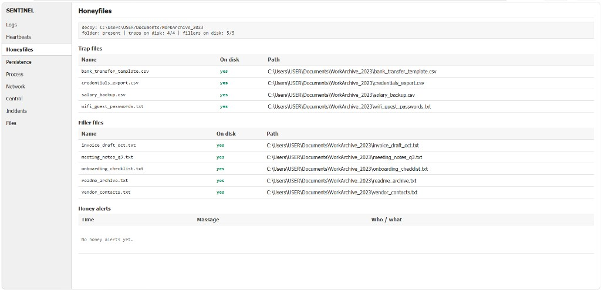
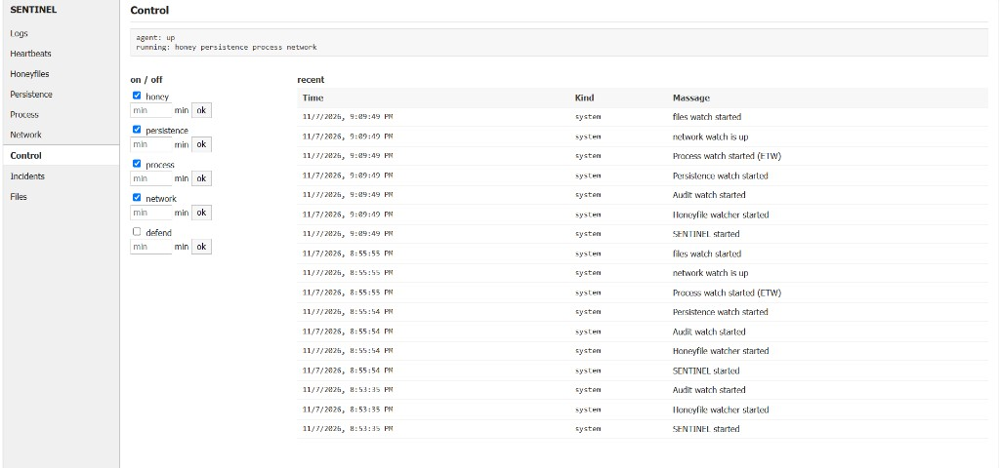

# SENTINEL

## what is this?

SENTINEL is a security system that combines many small mechanisms to ensure your computer is always secure.
This runs on your computer, alerts you if something suspicious is found, and sometimes blocks it.
It's there to keep my computer more secure. Of course, it still doesn't cover every possible attack vector, but at least it helps.
It's suitable for people who want to protect their computers from hackers or unwanted processes.

## what's inside

Well, SENTINEL has several different mechanisms designed to protect the computer from hacking attempts. I think I'll go over them:
so honeyfiles are trap files that get created automatically when you run the python agent.
when someone tries to open one or change it, it can alert or kill the process. and sometimes it auto-restores the file if it got deleted.
persistence watches the usual startup places, like Run keys and the Startup folder (and tasks a bit too).
if something new shows up there it alerts you, and if defend is on it tries to delete that new entry.
process learns which programs you usually run and alerts if something weird shows up.
network watches connections going out and alerts if something looks off.
files watches specific files you pick (like hosts) and alerts if they change.
incidents just puts related alerts in one place when a few happen close together.
the dashboard shows the alerts and lets you turn stuff on/off on the control page.
defend is the mode that actually does things on the computer, like killing a process. its off by default, you can turn it on in settings.

## built in

The agent built with python, the dashboard built with JS + CSS + HTML
some libraries from requirements.txt
ahh, yes, and it's 100% local 

## how to run

pip install -r requirements.txt
to run the agent: just use python main.py from the agent folder
to run the dashboard: use python server.py from the dashboard folder
the dashboard runs locally on this address by default: http://127.0.0.1:8787
and install_startup.bat is optional
to start defend, use the button in control page in the dashboard
some of these will work better if you run as administrator

## screenshots
honeyfiles page:

control page:

## license

MIT 

## notes

this is windows only.
defend starts off on purpose, turn it on from the control page if you want it to actually kill/block stuff.
network can get loud at first with normal apps (browser, cursor, etc).
some parts (audit / firewall) work better if you run the agent as admin.